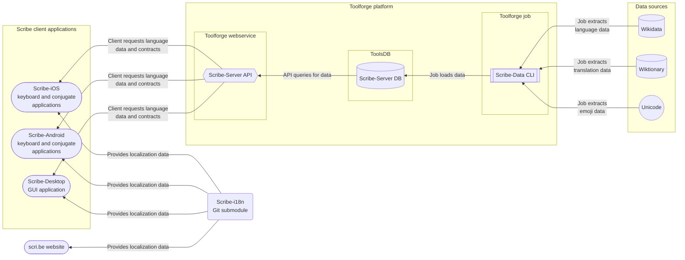

# [Architecture](https://github.com/scribe-org/Organization/blob/main/ARCHITECTURE.md)

This markdown file documents the architecture for the whole of [Scribe](https://github.com/scribe-org) - including the applications, the services, the processes and the external systems and sources with which it interacts. As the file is meant to be a living document, edits are welcome to expand and update it!

> [!NOTE]
> You can see the architecture diagram for the [Scribe-Data](https://github.com/scribe-org/Scribe-Data) CLI [here](https://github.com/scribe-org/Scribe-Data/blob/main/ARCHITECTURE.md).

## Architecture Diagram

The following diagram represents the relationships between the Scribe projects and external systems and sources, as they relate to the current and long term development plans for Scribe.

> [!NOTE]
> The architecture diagram above was created using the diagramming tool [Mermaid](https://github.com/mermaid-js/mermaid), with rendering supported in GitHub markdown.
