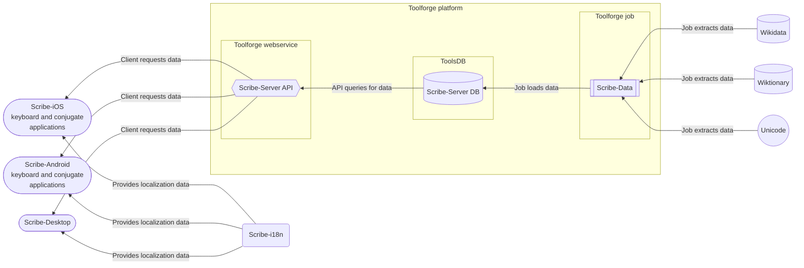

# [Architecture](https://github.com/scribe-org/Organization/blob/main/ARCHITECTURE.md)

This markdown file documents the architecture for the whole of [Scribe](https://github.com/scribe-org) - including the applications, the services, the processes and the external systems and sources with which it interacts. As the file is meant to be a living document, edits are welcome to expand and update it!

> [!NOTE]
> You can see the architecture diagram for the [Scribe-Data](https://github.com/scribe-org/Scribe-Data) CLI [here](https://github.com/scribe-org/Scribe-Data/blob/main/ARCHITECTURE.md).

## Architecture Diagram

The following diagram represents the relationships between the Scribe projects and external systems and sources, as they relate to the development plans for Scribe. In other words, the shown architecture depicts the complete state for Scribe, which is subject to revision if plans for Scribe change.

> [!NOTE]
> The architecture diagram above was created using [Mermaid](https://github.com/mermaid-js/mermaid), the diagramming tool with rendering supported in GitHub markdown.
